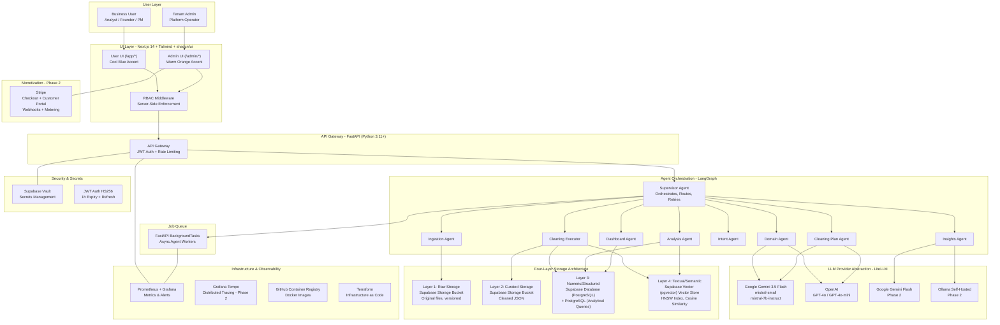
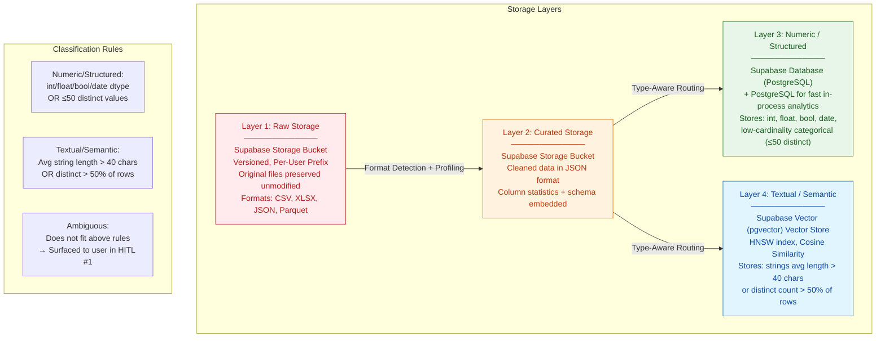
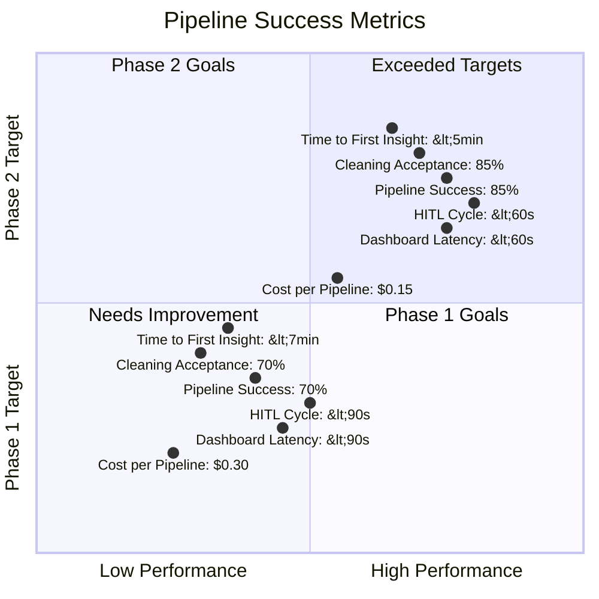
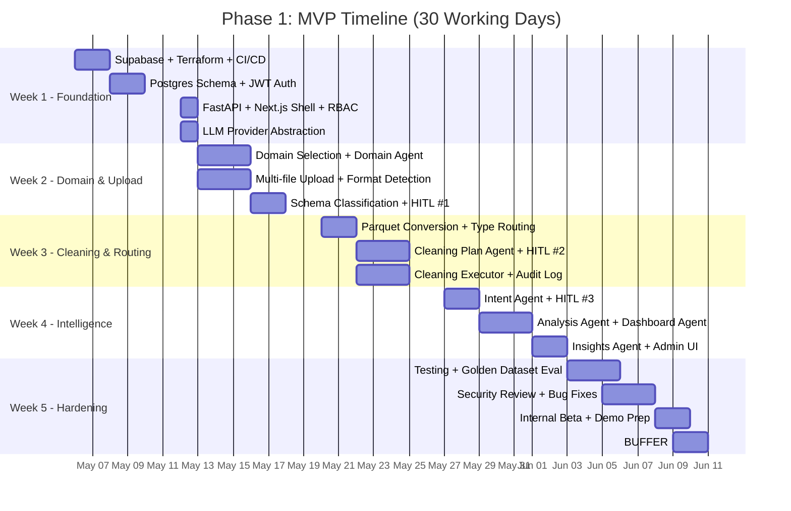
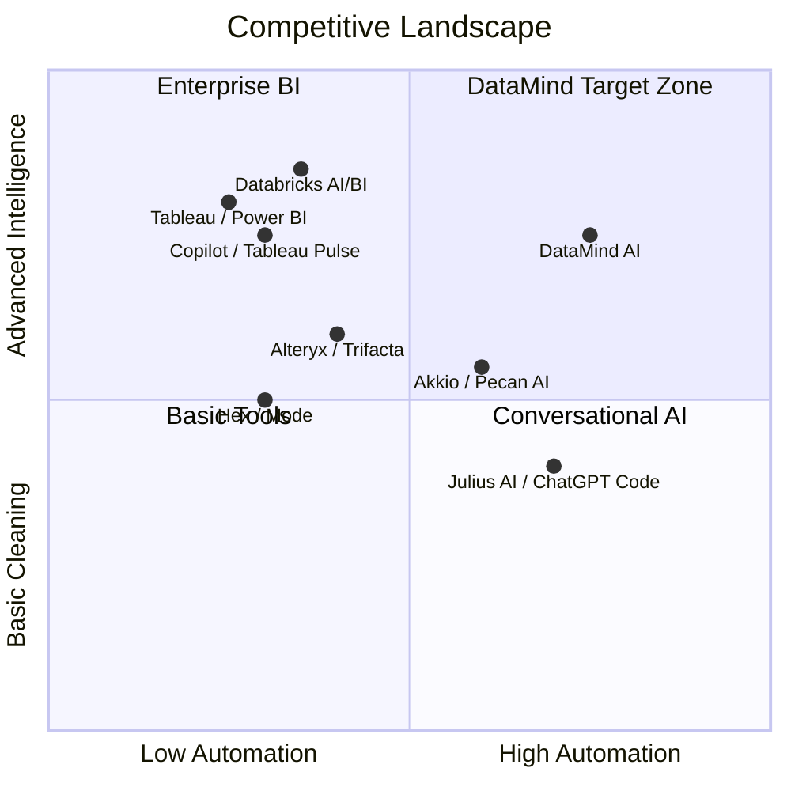

# DataMind AI — Architecture Diagram

> *Present this as a visual slide deck. Each section corresponds to one slide.*

---

## Slide 1: High-Level System Architecture



---

## Slide 2: End-to-End Data Pipeline Flow

```mermaid
flowchart LR
 %% Styling
 classDef domain fill:#e1f5fe,stroke:#0288d1,color:#01579b
 classDef ingest fill:#fff3e0,stroke:#f57c00,color:#bf360c
 classDef cleaning fill:#e8f5e9,stroke:#388e3c,color:#1b5e20
 classDef intent fill:#f3e5f5,stroke:#7b1fa2,color:#4a148c
 classDef dashboard fill:#fff8e1,stroke:#f9a825,color:#f57f17
 classDef storage fill:#eceff1,stroke:#546e7a,color:#263238
 classDef hitl fill:#ffcc02,stroke:#f57f17,color:#e65100

 %% Phase 1: Domain
 D[Domain Selection<br/>Finance / Healthcare / Retail /<br/>Marketing / Operations / Other]:::domain
 DP[Domain Prompt Pack Loaded<br/>Vocabulary, KPIs, Validation Rules]:::domain

 %% Phase 2: Upload
 UP[Upload Files<br/>CSV / XLSX / JSON / Parquet<br/>Up to 10 files, 50MB each]:::ingest
 L1[(Layer 1: Raw Storage<br/>Supabase Storage)]:::storage

 %% Phase 3: Detect & Profile
 DET[Format Detection +<br/>Column Profiling +<br/>Type Classification]:::ingest
 TCLASS{Type Classification<br/>Numeric/Structured vs<br/>Textual/Semantic}

 %% Phase 4: HITL #1
 H1{HITL #1<br/>Schema & Merge Validation}:::hitl
 MERGE[Approve/Modify Merge Plan<br/>UNION / JOIN / Keep Separate<br/>Edit Type Routing]:::ingest

 %% Phase 5: Conversion
 CONV[Convert to Parquet<br/>Apply Approved Merge]:::cleaning

 %% Phase 6: Cleaning Plan
 CP[Cleaning Plan Agent<br/>Generates Numbered Steps<br/>Dedup / Impute / Type Coercion]:::cleaning

 %% Phase 7: HITL #2
 H2{HITL #2<br/>Cleaning Plan Review}:::hitl
 APPROVE[User Approves / Modifies / Rejects<br/>Each Step Individually]:::cleaning

 %% Phase 8: Execute
 EXEC[Cleaning Executor<br/>Runs Only Approved Steps<br/>Logs Every Action]:::cleaning
 L2[(Layer 2: Curated Storage<br/>JSON)]:::storage
 L3[(Layer 3: Supabase DB<br/>+ PostgreSQL)]:::storage
 L4[(Layer 4: Supabase Vector (pgvector)<br/>Vector Store)]:::storage

 %% Phase 9: Intent
 IC[User States Question<br/>Free-text + Suggestion Chips]:::intent
 H3{HITL #3<br/>Intent Confirmation}:::hitl
 IR[Intent Agent Restates<br/>Interpretation]:::intent

 %% Phase 10: Analyze
 ALZ[Analysis Agent<br/>SQL on Numeric /<br/>Semantic Search on Text]:::intent

 %% Phase 11: Dashboard
 DG[Dashboard Agent<br/>KPI Cards + 2 Charts<br/>Vega-Lite Specs]:::dashboard
 IG[Insights Agent<br/>Domain-Flavored Narrative<br/>+ Recommended Action]:::dashboard
 AUDIT[(Audit Log<br/>Every Decision Logged)]:::storage

 %% Flow Connections
 D --> DP
 DP --> UP
 UP --> L1
 L1 --> DET
 DET --> TCLASS
 TCLASS --> H1
 H1 --> MERGE
 MERGE --> CONV
 CONV --> CP
 CP --> H2
 H2 --> APPROVE
 APPROVE --> EXEC
 EXEC --> L2
 EXEC --> L3
 EXEC --> L4
 L2 --> IC
 L3 --> IC
 L4 --> IC
 IC --> H3
 H3 --> IR
 IR --> ALZ
 ALZ --> DG
 ALZ --> IG
 DG --> AUDIT
 IG --> AUDIT
```

---

## Slide 3: Four-Layer Storage Architecture



---

## Slide 4: Agent System & Confidence Scoring

```mermaid
graph LR
 %% Style
 classDef supervisor fill:#ffcc02,stroke:#f57f17,color:#e65100,stroke-width:3
 classDef agent fill:#e3f2fd,stroke:#1565c0,color:#0d47a1
 classDef p2 fill:#f5f5f5,stroke:#9e9e9e,color:#616161,stroke-dasharray: 5 5

 SUP["Supervisor Agent<br/>═══════════════<br/>Orchestrates pipeline<br/>Routes between agents<br/>Handles retries & aggregation<br/>Enforces HITL gates"]:::supervisor

 subgraph "Phase 1 Agents (Supervised)"
  direction TB
  DA[Domain Agent<br/>Loads domain prompt pack]:::agent
  IA[Ingestion Agent<br/>Format detection, profiling,<br/>column classification]:::agent
  CPA[Cleaning Plan Agent<br/>Drafts cleaning plan,<br/>does NOT execute]:::agent
  CEA[Cleaning Executor<br/>Executes approved steps<br/>Logs every action]:::agent
  ITA[Intent Agent<br/>Parses NL goal into<br/>structured analysis spec]:::agent
  ANA[Analysis Agent<br/>SQL on numeric (PostgreSQL/Postgres)<br/>Semantic search on text (Supabase Vector (pgvector))]:::agent
  DSA[Dashboard Agent<br/>Converts analysis results<br/>into Vega-Lite specs]:::agent
  INA[Insights Agent<br/>Generates domain-flavored<br/>narrative + next action]:::agent
 end

 subgraph "Phase 2 Agents"
  OA[Outlier Agent<br/>Statistical outlier detection<br/>IQR + Isolation Forest]:::p2
  FDA[Fuzzy Dedup Agent<br/>Near-duplicate detection<br/>using fuzzy string match]:::p2
  SIA[Smart Imputation Agent<br/>KNN imputation<br/>LLM-assisted for high-cardinality]:::p2
  PII[PII Detection Agent<br/>Detects emails, phones, IDs<br/>Gates LLM context]:::p2
 end

 SUP --> DA
 SUP --> IA
 SUP --> CPA
 SUP --> CEA
 SUP --> ITA
 SUP --> ANA
 SUP --> DSA
 SUP --> INA
 SUP --> OA
 SUP --> FDA
 SUP --> SIA
 SUP --> PII

 subgraph "Confidence Score Framework"
  C1["0.90-1.00: High<br/>Pre-checked for approval"]
  C2["0.70-0.89: Medium<br/>Pre-checked, flagged yellow"]
  C3["0.50-0.69: Low<br/>Unchecked, flagged orange"]
  C4["0.00-0.49: Very Low<br/>Unchecked, flagged red"]
 end
```

---

## Slide 5: HITL (Human-in-the-Loop) Checkpoints

```mermaid
flowchart TB
 %% Style
 classDef hitl fill:#ffcc02,stroke:#f57f17,color:#e65100,stroke-width:3
 classDef user fill:#e1f5fe,stroke:#0288d1,color:#01579b
 classDef system fill:#e8f5e9,stroke:#388e3c,color:#1b5e20
 classDef decision fill:#fff3e0,stroke:#f57c00,color:#bf360c

 START([Upload Complete]):::system

 H1{HITL #1<br/>Schema & Merge Validation}:::hitl
 H1_CONTENT[User Sees:<br/>• Inferred schema per file<br/>• Proposed type-routing badges<br/>• Proposed merge plan (UNION/JOIN)<br/>• Sample rows preview<br/><br/>User Can:<br/>• Approve all<br/>• Change merge key<br/>• Change type-routing<br/>• Exclude columns/files]:::user

 H1_DECISION{User Decision}:::decision
 H1_APP[Approve]:::system
 H1_MOD[Modify & Approve]:::system

 H2{HITL #2<br/>Cleaning Plan Approval}:::hitl
 H2_CONTENT[User Sees:<br/>• Numbered cleaning actions<br/>• Rationale per step<br/>• Confidence badge per step<br/>• Before/after sample tables<br/><br/>User Can:<br/>• Approve all / Reject all<br/>• Approve/modify/reject per step<br/>• Switch imputation strategies]:::user

 H2_DECISION{User Decision}:::decision
 H2_APP[Approve All]:::system
 H2_MOD[Modify Some]:::system
 H2_REJ[Reject Some]:::system

 H3{HITL #3<br/>Intent Confirmation}:::hitl
 H3_CONTENT[User Sees:<br/>• Free-text input with domain-tuned placeholder<br/>• 3 suggestion chips<br/>• Agent restates interpretation<br/><br/>User Can:<br/>• Confirm intent<br/>• Refine / rephrase]:::user

 H3_DECISION{User Decision}:::decision
 H3_APP[Confirm]:::system
 H3_REF[Refine]:::system

 H4{HITL #4 - Phase 2<br/>Dashboard Accept/Refine}:::hitl
 H4_CONTENT[User Sees:<br/>• Generated dashboard<br/>• KPI cards + charts + narrative<br/><br/>User Can:<br/>• Accept dashboard<br/>• Request changes<br/>• Ask follow-up question]:::user

 H4_DECISION{User Decision}:::decision
 H4_APP[Accept]:::system
 H4_REQ[Request Changes]:::system
 H4_FUP[Follow-up Q&A]:::system

 DONE([Dashboard Ready]):::system

 %% Connections
 START --> H1
 H1 --> H1_CONTENT
 H1_CONTENT --> H1_DECISION
 H1_DECISION --> H1_APP
 H1_DECISION --> H1_MOD
 H1_APP --> H2
 H1_MOD --> H2
 H2 --> H2_CONTENT
 H2_CONTENT --> H2_DECISION
 H2_DECISION --> H2_APP
 H2_DECISION --> H2_MOD
 H2_DECISION --> H2_REJ
 H2_APP --> H3
 H2_MOD --> H3
 H2_REJ --> H3
 H3 --> H3_CONTENT
 H3_CONTENT --> H3_DECISION
 H3_DECISION --> H3_APP
 H3_DECISION --> H3_REF
 H3_REF --> H3_CONTENT
 H3_APP --> H4
 H4 --> H4_CONTENT
 H4_CONTENT --> H4_DECISION
 H4_DECISION --> H4_APP
 H4_DECISION --> H4_REQ
 H4_DECISION --> H4_FUP
 H4_REQ --> H4_CONTENT
 H4_FUP --> H4_CONTENT
 H4_APP --> DONE
```

---

## Slide 6: Technology Stack & Deployment

```mermaid
graph TB
 %% Style
 classDef frontend fill:#e1f5fe,stroke:#0288d1,color:#01579b
 classDef backend fill:#fff3e0,stroke:#f57c00,color:#bf360c
 classDef storage fill:#e8f5e9,stroke:#388e3c,color:#1b5e20
 classDef infra fill:#f3e5f5,stroke:#7b1fa2,color:#4a148c
 classDef ci fill:#ffebee,stroke:#c62828,color:#b71c1c

 subgraph "Frontend"
  NEXT[Next.js 14 + TypeScript]:::frontend
  TW[Tailwind CSS + shadcn/ui]:::frontend
  RC[Recharts / Vega-Lite]:::frontend
  UI[User UI /app/*]:::frontend
  ADM[Admin UI /admin/*]:::frontend
 end

 subgraph "Backend"
  API[FastAPI Python 3.11+<br/>Pydantic v2 Schemas]:::backend
  JWT[JWT Auth HS256<br/>RBAC Middleware]:::backend
  CELERY[FastAPI BackgroundTasks Workers<br/>Async Agent Tasks]:::backend
  REDIS[Redis<br/>Message Broker + Cache]:::backend
 end

 subgraph "Storage & Data"
  SUPABASE[Supabase<br/>PostgreSQL + Storage]:::storage
  DUCKDB[PostgreSQL<br/>Analytical Query Engine]:::storage
  WEAV[Supabase Vector (pgvector)<br/>Vector Embeddings]:::storage
  PARQUET[JSON<br/>Columnar Format]:::storage
 end

 subgraph "AI / LLM"
  LG[LangGraph<br/>Agent Orchestration]:::backend
  LITELLM[LiteLLM<br/>Provider Abstraction]:::backend
  MISTRAL[Google Gemini 3.5 Flash AI]:::backend
  OPENAI[OpenAI]:::backend
  GEMINI[Google Gemini Flash<br/>Phase 2]:::backend
  OLLAMA[Ollama Self-Hosted<br/>Phase 2]:::backend
 end

 subgraph "Infrastructure"
  DOCKER[Docker Containers<br/>python:3.11-slim / node:20-alpine]:::infra
  ECS[AWS ECS<br/>Blue/Green Deploy]:::infra
  GHCR[GitHub Container Registry]:::infra
  TF[Terraform<br/>Infrastructure as Code]:::infra
 end

 subgraph "CI/CD"
  GHA[GitHub Actions]:::ci
  LINT[Ruff + ESLint]:::ci
  TYPE[mypy + tsc]:::ci
  TEST[Pytest + Vitest<br/>Golden Dataset Evaluation]:::ci
  DEPLOY[Deploy to Staging → Prod<br/>Auto-rollback on >1% errors]:::ci
 end

 subgraph "Observability"
  PROM[Prometheus Metrics]:::infra
  GRAF[Grafana Dashboards]:::infra
  STRUC[Structlog<br/>Structured JSON Logging]:::infra
  OTEL[OpenTelemetry<br/>Phase 2]:::infra
 end

 subgraph "Security"
  VAULT[Supabase Vault<br/>Secrets]:::infra
  ARGON[Argon2<br/>Password Hashing]:::infra
  TLS[TLS 1.3<br/>Encryption in Transit]:::infra
  AES[AES-256<br/>Encryption at Rest]:::infra
 end

 subgraph "Monetization - Phase 2"
  STRIPE[Stripe<br/>Checkout + Portal<br/>Webhooks + Metering]:::infra
  PLAN[Free | Pro $49 | Team $199<br/>Enterprise Custom]:::infra
 end

 %% Connections
 NEXT --> TW
 NEXT --> RC
 NEXT --> UI
 NEXT --> ADM
 UI --> API
 ADM --> API
 API --> JWT
 API --> CELERY
 CELERY --> REDIS
 API --> SUPABASE
 API --> DUCKDB
 API --> WEAV
 SUPABASE --> PARQUET
 LG --> LITELLM
 LITELLM --> MISTRAL
 LITELLM --> OPENAI
 LITELLM --> GEMINI
 LITELLM --> OLLAMA
 DOCKER --> ECS
 GHCR --> ECS
 TF --> ECS
 GHA --> LINT
 GHA --> TYPE
 GHA --> TEST
 GHA --> DEPLOY
 API --> PROM
 CELERY --> PROM
 PROM --> GRAF
 API --> STRUC
 API --> OTEL
 API --> VAULT
 API --> ARGON
 API --> TLS
 API --> AES
 ADM --> STRIPE
 STRIPE --> PLAN
```

---

## Slide 7: Performance Targets & Key Metrics



---

## Slide 8: Deployment Pipeline & Environments

```mermaid
graph LR
 %% Style
 classDef dev fill:#e8f5e9,stroke:#388e3c,color:#1b5e20
 classDef staging fill:#fff3e0,stroke:#f57c00,color:#bf360c
 classDef prod fill:#ffebee,stroke:#c62828,color:#b71c1c
 classDef ci fill:#e1f5fe,stroke:#0288d1,color:#01579b

 DEV[Dev Environment<br/>Local Docker Compose<br/>+ LocalStack<br/>Synthetic Data]:::dev
 STAG[Staging Environment<br/>Single ECS Service<br/>25% Prod Capacity<br/>Anonymized Prod Data]:::staging
 PROD[Production Environment<br/>Auto-scaling ECS<br/>Multi-AZ RDS (P2)<br/>Live Traffic]:::prod

 subgraph "CI/CD Pipeline - GitHub Actions"
  PR[PR Opened<br/>Lint → TypeCheck<br/>→ Unit Tests → Docker Build<br/>< 5 min]:::ci
  MERGE[Merge to Main<br/>Tests → Deploy to Staging<br/>→ E2E Happy Path<br/>< 10 min]:::ci
  PROMOTE[Manual Promote to Prod<br/>Blue/Green Deploy<br/>10-min Health Check<br/>Auto-rollback >1% errors<br/>< 15 min]:::ci
  NIGHTLY[Nightly<br/>Full Agent Evaluation<br/>→ Internal Dashboard<br/>Background]:::ci
 end

 PR --> MERGE
 MERGE --> STAG
 STAG --> PROMOTE
 PROMOTE --> PROD
 NIGHTLY --> STAG
 DEV --> PR
```

---

## Slide 9: Timeline — Phase 1 (6 May – 10 June 2026)



---

## Slide 10: Competitive Positioning



> **Note:** Mermaid diagrams render in GitHub, GitLab, Notion, Obsidian, and most modern markdown viewers. For PowerPoint/Google Slides, export these as SVG or PNG using a Mermaid live editor (https://mermaid.live).
