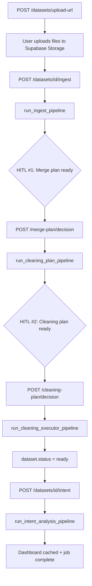

# DataMind AI — LangGraph Orchestration Analysis

**Document version:** 1.0  
**Date:** June 27, 2026  
**Scope:** Full analysis from codebase inspection through architectural recommendation  
**Audience:** Engineering team, product, and stakeholders reviewing Phase 1 orchestration decisions  
**Related PRD:** `docs/DataMind_AI_PRD_Phase1_Orchestration.docx` (PRD updated to match this analysis)

---

## Table of Contents

1. [Executive Summary](#1-executive-summary)
2. [Initial Question & Short Answer](#2-initial-question--short-answer)
3. [What Actually Runs the Pipeline Today](#3-what-actually-runs-the-pipeline-today)
4. [End-to-End Pipeline Flow (Detailed)](#4-end-to-end-pipeline-flow-detailed)
5. [How Each Stage Works in tasks.py](#5-how-each-stage-works-in-taskspy)
6. [What LangGraph Was Designed to Do (supervisor.py)](#6-what-langgraph-was-designed-to-do-supervisorpy)
7. [Gap Analysis: PRD vs Implementation](#7-gap-analysis-prd-vs-implementation)
8. [Why tasks.py Was Used Instead of LangGraph](#8-why-taskspy-was-used-instead-of-langgraph)
9. [Git History Evidence](#9-git-history-evidence)
10. [Sprint Tasks Never Completed](#10-sprint-tasks-never-completed)
11. [What Would Change If You Migrated to LangGraph](#11-what-would-change-if-you-migrated-to-langgraph)
12. [Would LangGraph Be Better Than Today?](#12-would-langgraph-be-better-than-today)
13. [Recommendation: Stick or Migrate?](#13-recommendation-stick-or-migrate)
14. [Incremental Migration Path (If You Choose LangGraph Later)](#14-incremental-migration-path-if-you-choose-langgraph-later)
15. [File Reference Index](#15-file-reference-index)
16. [Appendix: Architecture Diagrams](#16-appendix-architecture-diagrams)

---

## 1. Executive Summary

| Question | Answer |
|---|---|
| Is LangGraph orchestration actually running? | **No.** |
| Is there an `async.py` file? | **No.** The pipeline runs through `backend/app/workers/tasks.py`. |
| Are the agents working? | **Yes.** Ingestion, cleaning plan, cleaning executor, intent, analysis, dashboard, and insights agents all run — but they are called **directly** from async task functions, not through a LangGraph graph. |
| Does `supervisor.py` exist? | **Yes**, but `build_pipeline_graph()` is **never called** anywhere in the codebase. |
| Is the current approach wrong? | **No for Phase 1.** It is a pragmatic shortcut that matches the fixed linear pipeline and HTTP-driven HITL gates. LangGraph remains the **long-term target** per the PRD. |
| What should you do? | **Stick with `tasks.py` for Phase 1.** Revisit LangGraph when Phase 2 needs durable checkpointing, worker pools, iterative Q&A, or graph-level retries. |

---

## 2. Initial Question & Short Answer

### Question asked

> Can you check in my DataMind folder if LangGraph orchestration is actually working or it is taking an agentic flow through `async.py`? Tell me in detail how LangGraph orchestration is working.

### Short answer

**LangGraph orchestration is not actually running in your DataMind project today.**

- There is **no `async.py`** in the repository.
- The real pipeline runs through **`backend/app/workers/tasks.py`** — a set of **async Python functions** dispatched by **FastAPI `BackgroundTasks`** from API routes in `datasets.py` and `dashboards.py`.
- **`supervisor.py`** defines a LangGraph graph, but it is **never invoked** anywhere in the codebase (no `.invoke()`, `.ainvoke()`, or import from routes/tasks/tests).

The system **is agentic** (LLM-driven agents run at each stage), but **orchestration is imperative**, not graph-based.

---

## 3. What Actually Runs the Pipeline Today

### 3.1 Two layers in the PRD (often confused)

The PRD specifies **two separate concerns**:

| Layer | PRD specification | Current status |
|---|---|---|
| **Job queue / async dispatch** | FastAPI `BackgroundTasks` (Phase 1) | ✅ Implemented |
| **Agent orchestration** | LangGraph supervisor state machine | ❌ Scaffold only |

### 3.2 Intended architecture (per PRD/docs)

```
User UI → API Gateway → BackgroundTasks → LangGraph Supervisor → Agent nodes
```

### 3.3 Actual architecture (what runs in production code)

```
User UI → API Gateway → BackgroundTasks → tasks.py (async functions) → Agents directly
```

### 3.4 Entry points: API → Background task

| User action | API endpoint | Background task function |
|---|---|---|
| Upload complete → ingest | `POST /api/v1/datasets/{id}/ingest` | `run_ingest_pipeline` |
| Approve merge (HITL #1) | `POST /api/v1/datasets/{id}/merge-plan/decision` | `run_cleaning_plan_pipeline` |
| Approve cleaning (HITL #2) | `POST /api/v1/datasets/{id}/cleaning-plan/decision` | `run_cleaning_executor_pipeline` |
| Submit question (HITL #3) | `POST /api/v1/datasets/{id}/intent` | `run_intent_analysis_pipeline` |
| Regenerate dashboard | `POST /api/v1/dashboards/generate` | `run_dashboard_pipeline` |

**Source:** `backend/app/api/v1/datasets.py`, `backend/app/api/v1/dashboards.py`

Example from `datasets.py`:

```python
from app.workers.tasks import run_ingest_pipeline
job_id = str(uuid.uuid4())
background_tasks.add_task(run_ingest_pipeline, str(dataset_id), str(current_user["user_id"]), job_id)
```

### 3.5 Job status polling

Progress is tracked in an **in-memory dictionary** in `backend/app/api/v1/jobs.py`:

```python
# In-memory job registry (P1 — BackgroundTasks has no persistent job store)
_job_registry: dict[str, dict] = {}
```

Each pipeline stage creates a **separate job ID**. The frontend polls `GET /api/v1/jobs/{job_id}` until complete.

---

## 4. End-to-End Pipeline Flow (Detailed)



**Key behavior:** Each HITL gate is a **hard stop**. The pipeline does not continue until the user submits a decision via a **new HTTP request**, which enqueues a **new background task**.

---

## 5. How Each Stage Works in tasks.py

**File:** `backend/app/workers/tasks.py`

Each `run_*_pipeline` function follows the same pattern:

1. Open async DB session (`AsyncSessionLocal`)
2. Load dataset + files from Supabase Storage
3. Instantiate agents directly (no supervisor)
4. Update job progress via `update_job()` in the in-memory registry
5. Write results to Postgres / Supabase Storage / pgvector
6. Set `dataset.status` to pause or continue

---

### 5.1 Stage 1 — `run_ingest_pipeline`

**Triggered by:** `POST /datasets/{id}/ingest`

**What it does:**

1. Downloads archived files from Supabase Storage (Layer 1)
2. **`IngestionAgent`**: detect format → parse → profile columns → propose merge plan
3. Saves merge plan to `hitl_decisions` table (checkpoint: `schema_merge`)
4. Sets `dataset.status = "awaiting_hitl_merge"`
5. Creates `PipelineRun` with status `paused_for_hitl`
6. Uploads `_summary.json` (non-fatal)

**Agents used:** `IngestionAgent` only

**Stops here** — waits for user to approve/reject merge plan.

---

### 5.2 Stage 2 — `run_cleaning_plan_pipeline`

**Triggered by:** `POST /datasets/{id}/merge-plan/decision` (when `approved=true`)

**What it does:**

1. Re-downloads and re-parses all files from archive
2. Loads HITL #1 proposal from `hitl_decisions`
3. Applies merge strategy via `_apply_merge()` helper (union / join / single / separate)
4. Re-profiles merged rows
5. Loads user domain from `User.active_domain`
6. **`CleaningPlanAgent.propose()`** — LLM generates numbered cleaning plan
7. Saves plan to `hitl_decisions` (checkpoint: `cleaning_plan`)
8. Sets `dataset.status = "awaiting_hitl_cleaning"`
9. Persists LLM token usage to `pipeline_runs`

**Agents used:** `IngestionAgent`, `CleaningPlanAgent`

**Stops here** — waits for user to approve/modify cleaning steps.

---

### 5.3 Stage 3 — `run_cleaning_executor_pipeline`

**Triggered by:** `POST /datasets/{id}/cleaning-plan/decision`

**What it does:**

1. Re-downloads, re-parses, re-applies merge
2. Loads cleaning plan from `hitl_decisions`
3. **`CleaningExecutorAgent.execute()`** — runs only user-approved steps
4. **Layer 2:** Uploads cleaned JSON to Supabase Storage
5. **Layer 3:** Routes numeric columns → PostgreSQL table `ds_{dataset_id}`
6. **Layer 4:** Embeds textual columns → pgvector (`dataset_embeddings`)
7. Writes audit log entries
8. Sets `dataset.status = "ready"`

**Agents used:** `IngestionAgent`, `CleaningExecutorAgent`

**Also uses:** `get_embedding_model()` (Qwen3-Embedding-0.6B)

**Storage routing:**

| Column classification | Destination |
|---|---|
| `numeric` | PostgreSQL typed table |
| `textual` | pgvector embeddings |

---

### 5.4 Stage 4 — `run_intent_analysis_pipeline`

**Triggered by:** `POST /datasets/{id}/intent` or `POST /dashboards/generate`

**What it does (chains four agents in one task):**

1. Loads cleaned JSON from Supabase Storage (fallback: re-parse archive)
2. Profiles columns
3. **`IntentAgent.parse()`** — natural language → `AnalysisSpec`
4. **`AnalysisAgent.run_numeric()`** — SQL on PostgreSQL
5. **`AnalysisAgent.run_textual()`** — cosine search on pgvector
6. **`DashboardAgent.generate()`** — KPI cards + chart specs
7. **`InsightsAgent.enrich()`** — domain-flavoured narrative
8. Caches dashboard via `cache_dashboard()`
9. Persists LLM token/cost to `pipeline_runs`

**Agents used:** `IntentAgent`, `AnalysisAgent`, `DashboardAgent`, `InsightsAgent`

One shared `LLMClient` accumulates tokens/cost across all four agents.

---

### 5.5 Helper: `_apply_merge()`

**Location:** `tasks.py` (lines 19–78)

Applies the HITL-confirmed merge strategy:

| Strategy | Behavior |
|---|---|
| `single` / one file | Return first file as-is |
| `union` | Vertical stack of all files |
| `join` | Left-join on key column (largest file drives) |
| `separate` / unknown | Stack with `_source_file` tag |

Excluded columns from HITL decision are stripped from all rows.

---

### 5.6 How HITL gates work (without LangGraph)

| Mechanism | Role |
|---|---|
| `dataset.status` | State machine: `uploaded` → `awaiting_hitl_merge` → `awaiting_hitl_cleaning` → `ready` |
| `hitl_decisions` table | Stores proposal JSON + user decision JSON per checkpoint |
| Separate API calls | User submits decision → new background task starts next stage |
| `_job_registry` | In-memory dict for job polling |

There is **no shared LangGraph state object**. Each task **re-downloads files** and **re-reads HITL decisions from Postgres** when it starts.

---

## 6. What LangGraph Was Designed to Do (supervisor.py)

**File:** `backend/app/agents/supervisor.py`

### 6.1 PipelineState (shared graph state)

```python
class PipelineState(TypedDict):
    dataset_id: str
    user_id: str
    job_id: str
    domain: str
    filenames: list[str]
    raw_rows: list[dict]
    column_profiles: list[dict]
    merge_plan: dict
    merge_decision: dict
    cleaning_plan: dict
    cleaning_decision: dict
    cleaned_rows: list[dict]
    audit_entries: list[dict]
    intent_question: str
    analysis_spec: dict
    numeric_results: list[dict]
    textual_results: list[dict]
    dashboard: dict
    error: str | None
    status: str
```

### 6.2 Defined graph nodes

| Node | Purpose |
|---|---|
| `load_domain` | Load domain prompt pack via `DomainAgent` |
| `ingest` | Profile columns + propose merge plan |
| `await_merge_hitl` | Pause at HITL #1 |
| `cleaning_plan` | Generate cleaning plan via LLM |
| `await_cleaning_hitl` | Pause at HITL #2 |
| `execute_cleaning` | Run approved cleaning steps |
| `intent` | Parse user question |
| `analyze` | Run SQL + semantic search |
| `dashboard` | Generate charts + insights |

### 6.3 Actual graph wiring (incomplete)

Only these edges exist:

```python
graph.set_entry_point("load_domain")
graph.add_edge("load_domain", "ingest")
graph.add_edge("ingest", "await_merge_hitl")
graph.add_edge("await_merge_hitl", END)
```

**Nodes defined but NOT connected:** `cleaning_plan`, `await_cleaning_hitl`, `execute_cleaning`, `intent`, `analyze`, `dashboard`

Even if invoked, the graph would **stop after HITL #1**.

### 6.4 Known stubs and gaps

| Issue | Detail |
|---|---|
| Never invoked | `build_pipeline_graph()` has zero call sites in the repo |
| Incomplete edges | Graph ends at `await_merge_hitl` |
| `node_analyze` is a stub | Logs *"Analysis requires DB session; executed in worker task"* and returns without doing work |
| `DomainAgent` unused in production | Only referenced inside `supervisor.py`; production path uses `User.active_domain` string directly |
| No conditional edges | No HITL resume routing, retry, or failure branches |
| No state persistence | Docs specify Supabase Storage + DB checkpointing (S3-07) — not implemented |

### 6.5 Lazy import with fallback

```python
try:
    from langgraph.graph import END, StateGraph
except ImportError:
    log.warning("langgraph_not_available", msg="LangGraph not installed; pipeline graph unavailable.")
    return None
```

LangGraph is listed in `pyproject.toml` (`langgraph>=0.1.0`) but the runtime path never uses it.

---

## 7. Gap Analysis: PRD vs Implementation

| Concern | PRD / docs target | Current implementation |
|---|---|---|
| Agent logic | Individual specialized agents | ✅ Working |
| Async execution | FastAPI BackgroundTasks | ✅ Working |
| Orchestration | LangGraph supervisor | ❌ Skeleton only |
| HITL pause/resume | Graph conditional edges + state persistence | ✅ Via DB status + separate API calls |
| Retry on failure | Supervisor retries | ⚠️ Task catches exception → job failed; manual re-trigger |
| Shared pipeline state | `PipelineState` in LangGraph | ⚠️ Each task re-loads from storage/DB |
| Domain loading | `DomainAgent` via supervisor node | ⚠️ Domain string from `User.active_domain` |
| Job progress | Graph step transitions | Manual `update_job()` strings |
| Multi-file merge | Full merge in pipeline | ✅ In `tasks.py`; supervisor noted as single-file only in docs |
| Analysis with DB | Full SQL + pgvector | ✅ In `tasks.py`; stub in supervisor |

### Side-by-side: planned vs actual

```
PLANNED:  API → BackgroundTasks → LangGraph graph.ainvoke() → agent nodes → checkpoint
ACTUAL:   API → BackgroundTasks → tasks.run_*_pipeline() → agents directly → dataset.status
```

---

## 8. Why tasks.py Was Used Instead of LangGraph

This was **not a documented architectural decision to abandon LangGraph**. It is **implementation gap / technical debt** from Phase 1 delivery pressure.

### 8.1 Both were created in the same boilerplate commit

Commit `40b189f` (May 27, 2026) added **both** files together:

- `backend/app/agents/supervisor.py` (128 lines)
- `backend/app/workers/tasks.py` (341 lines)

From the start, `supervisor.py` had all 9 nodes but only 3 edges (stopped at HITL #1). `tasks.py` contained the full working pipeline.

### 8.2 Sprint tasks for LangGraph were never completed

From `docs/tasks.md`:

| Task ID | Description | Status |
|---|---|---|
| S3-05 | LangGraph Supervisor — routing, HITL pause/resume, retry | Partial scaffold |
| S3-06 | HITL Gate Manager — pause/resume functions, state snapshot | Not implemented |
| S3-07 | Pipeline state persistence to Supabase after every step | Not implemented |

Engineering effort went into making the E2E path work in `tasks.py`.

### 8.3 Practical reasons tasks.py won

**1. HITL maps naturally to HTTP boundaries**

Each gate is already a separate user action + API call. Pause/resume is free via `dataset.status` without LangGraph checkpointing.

**2. Stages need heavy async I/O**

Each stage requires DB sessions, Supabase Storage, bulk PostgreSQL inserts, pgvector embeddings. This was implemented in `tasks.py`; the LangGraph `node_analyze` was left as a stub.

**3. PRD describes a fixed pipeline**

> *"DataMind is mostly a planned pipeline, not a reactive agent — for cleaning, the steps are known in advance."*

LangGraph's strength (dynamic routing, complex branching) is less critical for a fixed linear flow.

**4. Phase 1 simplification philosophy**

The PRD explicitly favors simplifications (BackgroundTasks over SQS, local dev friendly). Imperative task functions fit that mindset.

**5. Frontend built around per-stage jobs**

The UI polls `GET /jobs/{job_id}` after each user action. One job per stage — not one long-running graph spanning days of user review.

**6. All post-boilerplate fixes targeted tasks.py**

E2E testing found performance issues (re-parsing files, row-by-row inserts, embedding cold start). Fixes went into `tasks.py`, not supervisor wiring.

---

## 9. Git History Evidence

Commits touching `tasks.py` and/or `supervisor.py`:

| Commit | Description |
|---|---|
| `40b189f` | Initial boilerplate — **both files added together** |
| `2b88977` | Ingestion and dataset storage updates (`tasks.py`) |
| `6ff64f7` | LLM token/cost tracking for pipeline runs |
| `54e0356` | E2E performance, fallback, and UX fixes |
| `7945277` | Merge conflict resolution in `tasks.py` |
| `098e586` | Analysis pipeline, merge strategy, dashboard accuracy |

**Takeaway:** Every commit after boilerplate modified **`tasks.py`**. **`supervisor.py` has had no wiring changes since it was first added.**

---

## 10. Sprint Tasks Never Completed

The following were planned as dependencies for a working LangGraph path:

### S3-05 — LangGraph Supervisor
- State machine setup
- Step routing
- HITL pause/resume
- Retry on failure

### S3-06 — HITL Gate Manager
- `pause_pipeline_for_decision()`
- `resume_pipeline_with_decision()`
- State snapshot to Supabase Storage

### S3-07 — Pipeline State Persistence
- Serialize full pipeline state after every agent step
- Store in Supabase Storage + Supabase Database
- Enable worker crash recovery

Without S3-06 and S3-07, LangGraph provides little advantage over the current DB-driven HITL approach.

---

## 11. What Would Change If You Migrated to LangGraph

| Area | Now (`tasks.py`) | With LangGraph |
|---|---|---|
| **Flow control** | 4 separate async functions, API-triggered | One compiled graph with nodes + conditional edges |
| **HITL pause** | `dataset.status` + new background job per gate | Graph checkpoint; resume with same run/state |
| **State** | Re-download + re-read HITL rows each stage | Shared `PipelineState` persisted between steps |
| **Retries** | Fail → mark job failed; user re-triggers | Graph-level retry policies per node |
| **Observability** | `current_step` strings in memory | Traceable node transitions |
| **Worker restarts** | In-memory jobs lost on reload/crash | Checkpoint store survives restarts (if S3-07 done) |
| **Code complexity** | Straightforward Python | More abstraction; DI for DB/storage in nodes |
| **Frontend** | Unchanged if you keep API-stage boundaries | Could stay same with hybrid approach |

**What stays the same:** Individual agents, API contracts, HITL screens, storage layers, LLM abstraction.

---

## 12. Would LangGraph Be Better Than Today?

### For Phase 1 as built today: mostly no — not yet

The current design honestly implements a fixed linear pipeline with HTTP-driven HITL. LangGraph would add structure you are not fully using — especially without S3-06/S3-07. A half-wired graph would be **worse** than the working `tasks.py` path.

### LangGraph becomes meaningfully better when you need:

1. **Durable pipeline state** — worker pool, server restarts, long HITL waits without re-parsing
2. **Graph-level retry/routing** — e.g. LLM failure retries intent node only
3. **Phase 2 reactive flows** — iterative Q&A, branching analysis
4. **Unified audit trail** — one `run_id` spanning the full pipeline
5. **Team scale** — single orchestration contract vs logic spread across `tasks.py`

### Pain points LangGraph would NOT have fixed directly

From E2E testing and fixes documented in the repo:

- Embedding model cold start
- Re-computing column profiles every stage
- Row-by-row PostgreSQL inserts
- Job 404 after server `--reload`
- LLM quota exhaustion → heuristic fallbacks

These were solved inside `tasks.py`.

---

## 13. Recommendation: Stick or Migrate?

### Recommendation: **Stick with `tasks.py` for Phase 1**

Do **not** do a big-bang LangGraph migration before internal beta unless you hit a concrete blocker the current design cannot solve.

| Priority | Action |
|---|---|
| **Now** | Keep `tasks.py` as Phase 1 orchestration |
| **Now** | Document that runtime path is `tasks.py`; mark `supervisor.py` as WIP |
| **Optional now** | Extract shared helpers from `tasks.py` to reduce duplication (`_load_parsed_files`, etc.) |
| **Before Phase 2** | Plan LangGraph when adding worker pool + iterative Q&A |
| **If migrating** | Finish S3-06/S3-07 (checkpoint store) **before** wiring the full graph |

### When to migrate (trigger points)

Move to LangGraph when **any** of these become true:

- Phase 2 **iterative Q&A** on the same dataset
- Move from `BackgroundTasks` to a **dedicated worker pool**
- **Long HITL waits** make re-download/re-parse costly or fragile
- Need **automatic retries** with policy (not manual re-submit)
- Need **one pipeline run ID** end-to-end for audit/billing/observability

### Pragmatic middle path (if you want PRD alignment without full rewrite)

1. Keep **API-stage boundaries** (frontend unchanged)
2. Use LangGraph **inside stages** where it adds value (e.g. intent → analyze → dashboard as one subgraph)
3. Implement **S3-06/S3-07 first** — checkpoint store is what makes LangGraph worth the complexity

---

## 14. Incremental Migration Path (If You Choose LangGraph Later)

### Phase A — Foundation (do first)
- [ ] Implement checkpoint store (Postgres table or Supabase Storage JSON)
- [ ] Implement `pause_pipeline_for_decision()` / `resume_pipeline_with_decision()`
- [ ] Persist `PipelineState` after each node

### Phase B — Complete the graph
- [ ] Wire all edges in `supervisor.py` (currently stops at HITL #1)
- [ ] Add conditional edges for HITL resume
- [ ] Replace `node_analyze` stub with real DB-injected analysis
- [ ] Add retry policies on LLM nodes

### Phase C — Integrate with API (minimal frontend change)
- [ ] Option 1: One graph invocation per API stage (hybrid — lowest risk)
- [ ] Option 2: Full graph with interrupt/resume at HITL gates (higher effort)

### Phase D — Worker pool (Phase 2)
- [ ] Move graph execution to dedicated workers
- [ ] Replace in-memory job registry with persistent store
- [ ] Support long-running pipelines across restarts

---

## 15. File Reference Index

| File | Role | Runtime active? |
|---|---|---|
| `backend/app/workers/tasks.py` | **Production orchestration** — 5 async pipeline functions | ✅ Yes |
| `backend/app/agents/supervisor.py` | LangGraph graph definition (incomplete) | ❌ Never invoked |
| `backend/app/api/v1/datasets.py` | API routes → dispatches background tasks | ✅ Yes |
| `backend/app/api/v1/dashboards.py` | Dashboard generation route | ✅ Yes |
| `backend/app/api/v1/jobs.py` | In-memory job registry + polling | ✅ Yes |
| `backend/app/agents/ingestion.py` | Format detection, parsing, profiling, merge plan | ✅ Yes |
| `backend/app/agents/cleaning_plan.py` | LLM cleaning plan (does not execute) | ✅ Yes |
| `backend/app/agents/cleaning_executor.py` | Executes approved cleaning steps | ✅ Yes |
| `backend/app/agents/intent.py` | Parses user question → AnalysisSpec | ✅ Yes |
| `backend/app/agents/analysis.py` | SQL + pgvector search | ✅ Yes |
| `backend/app/agents/dashboard_agent.py` | KPI cards + charts | ✅ Yes |
| `backend/app/agents/insights.py` | Domain narrative | ✅ Yes |
| `backend/app/agents/domain.py` | Domain prompt packs | ⚠️ Only in supervisor scaffold |
| `backend/pyproject.toml` | Lists `langgraph>=0.1.0` dependency | Installed, unused at runtime |
| `docs/tasks.md` | Sprint tasks S3-05/06/07 for LangGraph | Planned, incomplete |
| `docs/PRD.md` | Specifies BackgroundTasks + `tasks.py` for Phase 1 orchestration | Implemented |

---

## 16. Appendix: Architecture Diagrams

### A. Current runtime (Phase 1)

```
┌─────────────┐     ┌──────────────────┐     ┌─────────────────────┐
│  Next.js UI │────▶│ FastAPI routes   │────▶│ BackgroundTasks     │
│  (poll job) │     │ datasets.py      │     │                     │
└─────────────┘     │ dashboards.py    │     └──────────┬──────────┘
                    └──────────────────┘                │
                                                        ▼
                                           ┌────────────────────────┐
                                           │ tasks.py               │
                                           │  run_ingest_pipeline   │
                                           │  run_cleaning_plan_*   │
                                           │  run_cleaning_exec_*   │
                                           │  run_intent_analysis_* │
                                           └──────────┬─────────────┘
                                                      │
                        ┌─────────────────────────────┼─────────────────────────────┐
                        ▼                             ▼                             ▼
                 IngestionAgent              CleaningPlanAgent                 IntentAgent
                 CleaningExecutor             AnalysisAgent                   DashboardAgent
                                              InsightsAgent
                        │                             │                             │
                        ▼                             ▼                             ▼
                 Supabase Storage              PostgreSQL                    pgvector
                 hitl_decisions                pipeline_runs                 audit_log
                 dataset.status
```

### B. PRD target (not yet wired)

```
┌─────────────┐     ┌──────────────────┐     ┌─────────────────────┐
│  Next.js UI │────▶│ FastAPI routes   │────▶│ BackgroundTasks     │
└─────────────┘     └──────────────────┘     └──────────┬──────────┘
                                                          │
                                                          ▼
                                           ┌────────────────────────┐
                                           │ supervisor.py          │
                                           │ LangGraph StateGraph   │
                                           │ PipelineState          │
                                           │  load_domain → ingest  │
                                           │  → await_merge_hitl    │
                                           │  → cleaning_plan → ... │
                                           │  → dashboard → END     │
                                           └──────────┬─────────────┘
                                                      │
                                                      ▼
                                              Agent nodes (same agents)
                                                      │
                                                      ▼
                                           Checkpoint store (S3-07)
                                           Postgres + Supabase Storage
```

### C. Dataset status state machine (current)

```
uploaded
   │
   ▼ (ingest)
profiling → awaiting_hitl_merge
   │
   ▼ (merge approved)
cleaning_plan → awaiting_hitl_cleaning
   │
   ▼ (cleaning approved)
executing → ready
   │
   ▼ (intent submitted)
dashboard generation (job complete)
```

---

## Document History

| Version | Date | Changes |
|---|---|---|
| 1.0 | 2026-06-27 | Initial comprehensive analysis document |

---

*Generated from codebase inspection of the DataMind repository. For questions or updates, revise this document when LangGraph integration status changes.*
